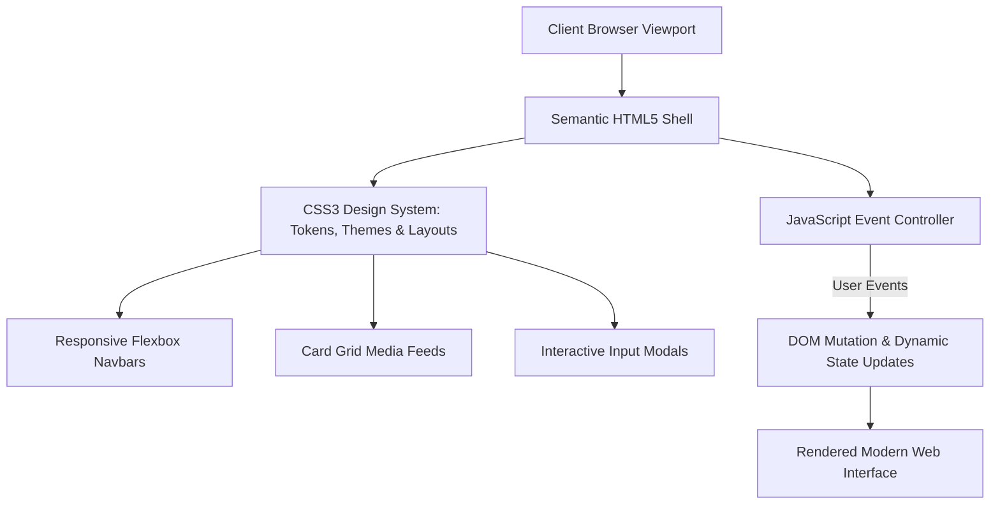

<div align="center">


[](https://developer.mozilla.org/en-US/docs/Web/HTML)
[](https://developer.mozilla.org/en-US/docs/Web/CSS)
[](https://developer.mozilla.org/en-US/docs/Web/JavaScript)
[](#)
[](#)

</div>

---

## 📌 Executive Summary / Overview

The **Full-Stack Web Engineering II Suite** (`FSD_PothamchettyJeswanthika2`) is an advanced coursework and development repository advancing full-stack client-side engineering, component design systems, and responsive user interfaces at Alliance University.

Building upon core semantic HTML and styling fundamentals, this module explores modern component modularity: dynamic Document Object Model (DOM) manipulation, event-driven reactive state controllers, CSS grid and flexbox alignment paradigms, and client-side form validation mechanisms.

---

## 📖 Interactive Table of Contents

- [Executive Summary / Overview](#-executive-summary--overview)
- [Key Features & Capabilities](#-key-features--capabilities)
- [System Architecture & Component Flow](#-system-architecture--component-flow)
- [Tech Stack Breakdown](#-tech-stack-breakdown)
- [Module Curriculum & Engineering Competencies](#-module-curriculum--engineering-competencies)
- [Reproducible Quickstart & Setup](#-reproducible-quickstart--setup)
- [Project Directory Layout](#-project-directory-layout)
- [Author & Contributions](#-author--contributions)

---

## ✨ Key Features & Capabilities

- **Modular UI Component Patterns**: Reusable card elements, interactive navigation menus, and dynamic modal overlays.
- **Event-Driven DOM Manipulation**: Pure JavaScript ES6+ event listeners responding to clicks, input transitions, and window resize events.
- **Responsive Layout Architecture**: Fluid CSS grid systems and flexible containers optimizing visual fidelity from mobile to desktop.
- **Client-Side Form Validation**: Real-time regex pattern matching, input sanitation, and accessible inline error messaging.
- **Modern Aesthetic Standards**: Polished user experiences implementing modern box-shadow depths, smooth CSS transitions, and subtle gradient highlights.

---

## 🏗️ System Architecture & Component Flow



---

## 🛠️ Tech Stack Breakdown

| Category | Technologies & Tools |
| :--- | :--- |
| **Markup Language** | HTML5 (Semantic Structure, Accessibility, Forms) |
| **Styling Engine** | CSS3 (Flexbox, CSS Grid, Transitions, Custom Properties) |
| **Client Scripting**| JavaScript (ES6+, DOM API, Event Delegation) |
| **Tools & Editors** | Visual Studio Code, Chrome DevTools, Git CLI |

---

## 📚 Module Curriculum & Engineering Competencies

| Competency Area | Technical Focus | Practical Implementation |
| :--- | :--- | :--- |
| **1. Semantic Structuring** | Accessibility, SEO metadata, semantic containers | HTML5 landmark elements |
| **2. Layout Engineering** | Responsive grid units, media queries, flexbox | Multi-column adaptive dashboards |
| **3. Reactive Interactivity** | Event bubbling, DOM updates, state toggles | Modal windows and interactive carousels |
| **4. Form Engineering** | Data sanitation, regex patterns, input types | High-conversion booking and contact forms |

---

## 🚀 Reproducible Quickstart & Setup

### Prerequisites
- Any modern web browser

### Step 1: Clone the Repository
```bash
git clone https://github.com/Jeshwanthika07/FSD_PothamchettyJeswanthika2.git
cd FSD_PothamchettyJeswanthika2
```

### Step 2: Open and Preview
```bash
# On Windows:
start index.html

# On Linux/macOS:
open index.html
```

---

## 📂 Project Directory Layout

```text
FSD_PothamchettyJeswanthika2/
│
├── README.md                  # Comprehensive technical documentation
└── LICENSE                    # Open-source MIT license
```

---

## 👩‍💻 Author & Contributions

Authored by **[Jeshwanthika Pothamchetty](https://github.com/Jeshwanthika07)**  
*Department of Computer Applications, Alliance University*

<div align="center">


</div>
